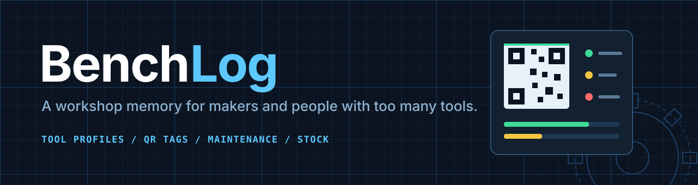
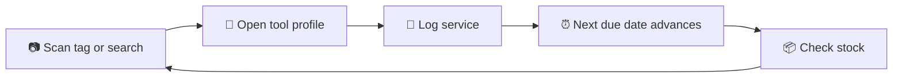
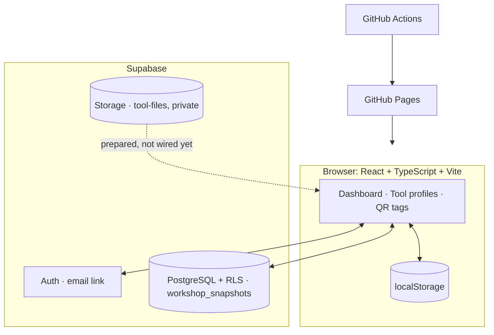

<div align="center">



<br/>

[](https://asmitcod.github.io/benchlog/)
[](https://github.com/Asmitcod/benchlog/actions/workflows/deploy-pages.yml)
[](#-status)

**[Features](#-what-it-does)** · **[How it works](#-the-care-loop)** · **[Quick start](#-quick-start)** · **[Status](#-status)** · **[Roadmap](#-roadmap)**

</div>

<!-- Add a screenshot here once you have one:  -->

---

## ✨ What it does

BenchLog keeps everything about your tools in one dashboard: what needs care, what you did last time, and what is running low.

<table>
  <tr>
    <td width="33%" valign="top">
      <h3>📊 Dashboard</h3>
      Tools, upcoming and overdue maintenance, low-stock items, restock count and the latest service note at a glance.
    </td>
    <td width="33%" valign="top">
      <h3>🧰 Tool profiles</h3>
      Category, make/model and location for every tool, with its maintenance and service history on one page.
    </td>
    <td width="33%" valign="top">
      <h3>🏷️ QR tool tags</h3>
      Generate a QR code per tool, copy its link or print a tag. Scan it at the bench to open the profile.
    </td>
  </tr>
  <tr>
    <td width="33%" valign="top">
      <h3>⏰ Reminders</h3>
      Weekly, monthly, quarterly, yearly or one-time schedules. Logging recurring work advances the next due date.
    </td>
    <td width="33%" valign="top">
      <h3>🧾 Service history</h3>
      Log scheduled or one-off work with a date and a note, and review recent notes in the tool profile.
    </td>
    <td width="33%" valign="top">
      <h3>📦 Consumables</h3>
      Quantity, capacity, unit, location and low-stock threshold. Adjust stock, flag items and filter the restock list.
    </td>
  </tr>
  <tr>
    <td width="33%" valign="top">
      <h3>☁️ Sync</h3>
      Email magic-link sign-in through Supabase, with your workshop synced across devices.
    </td>
    <td width="33%" valign="top">
      <h3>💾 Local backup</h3>
      If cloud data replaces what is in your browser, a JSON backup of the local copy is kept and downloadable.
    </td>
    <td width="33%" valign="top">
      <h3>🌗 Dark and light</h3>
      A high-contrast dark workshop theme by default, with a light mode, plus search across your tools.
    </td>
  </tr>
</table>

## 🔁 The care loop

BenchLog is organised around what you do with a tool each visit, not just a list of assets.



## 🧱 Built with

<p align="center">
  
</p>

<p align="center">
  <sub>Also: <b>Glisse</b> glass panels · <b>Motion</b> transitions · <b>React Three Fiber + Drei</b> tool illustration · <b>Lucide</b> icons · <b>qrcode.react</b> tags</sub>
</p>

### Architecture



The frontend talks to Supabase directly. Row Level Security keeps each account's data private. Flask in `backend/` is only a health-check scaffold and is not deployed.

## 🚀 Quick start

```powershell
git clone https://github.com/Asmitcod/benchlog.git
cd benchlog
npm ci
Copy-Item .env.example .env.local   # PowerShell; add your Supabase URL + publishable key
npm run dev
```

Open **http://localhost:5173/benchlog/**. Needs Node.js 22+.

No Supabase project yet? Skip the `.env.local` step. The app still runs on browser-local storage, and the sign-in dialog will say sync is not configured.

```dotenv
VITE_SUPABASE_URL=https://your-project.supabase.co
VITE_SUPABASE_PUBLISHABLE_KEY=your-supabase-publishable-key
```

| Command | What it does |
|---|---|
| `npm run dev` | Start the dev server |
| `npm run build` | Type-check, then production build |
| `npm run preview` | Preview the production build |

## 📍 Status

| Area | State |
|---|---|
| Dashboard, tool profiles, QR tags | ✅ Working |
| Reminders and service history | ✅ Working |
| Consumables and restock list | ✅ Working |
| GitHub Pages CI/CD | ✅ Working |
| Email sign-in and cloud sync | 🟡 Built, real sign-in email not yet verified end to end |
| Documents and file storage | 🚧 Database and bucket ready, no upload UI |
| Parts and setting presets | 🚧 Tables ready, no UI |
| Offline PWA, notifications, usage-hour maintenance, import/export | 🗓️ Planned |

<details>
<summary><b>⚠️ Known limitations (read before relying on it)</b></summary>

<br/>

- **Sample data:** the dashboard ships with illustrative starter content. Replace it before treating anything as a real record.
- **QR tags are not a security boundary:** a tag encodes the app URL and a tool ID. On another device the tool must already exist in the signed-in user's private data.
- **Whole-snapshot sync:** cloud sync replaces one JSON snapshot per user, with no field-level conflict handling. Let a sync finish before editing on another device.
- **Not an offline-first PWA yet:** no service worker or durable write queue. Local data keeps working and a reconnect retries the sync.
- **Backups are download-only:** importing a backup through the UI is not implemented.
- **Documents section:** the section and its tool-profile action are placeholders.

</details>

## 🗺️ Roadmap

- [x] Dashboard, tool profiles and printable QR tags
- [x] Service history and recurring maintenance reminders
- [x] Custom consumables and restock list
- [x] Supabase sign-in with cross-device snapshot sync
- [x] GitHub Pages build-and-deploy workflow
- [ ] Editable profiles with manuals, photos and documents in private storage
- [ ] Parts, supplier references and setting presets in the UI
- [ ] Per-entity sync with proper conflict handling
- [ ] Portable JSON import and export
- [ ] Installable PWA with an offline write queue
- [ ] Usage-hour maintenance, parts-used tracking and notifications
- [ ] Universally scannable QR links with a proper privacy and authorization design

---

## 🔧 Setup and reference

<details>
<summary><b>Supabase setup</b></summary>

<br/>

1. Create a Supabase project and apply the SQL in `supabase/migrations/` in filename order.
2. Copy the **project URL** and **publishable key** into `.env.local`.
3. Never put a `service_role`, secret key or database password in a `VITE_` variable. Vite embeds those in the public build.
4. Enable email sign-in, then set the Auth URLs:

| Setting | Value |
|---|---|
| Site URL | `https://asmitcod.github.io/benchlog/` |
| Redirect (production) | `https://asmitcod.github.io/benchlog/` |
| Redirect (local) | `http://localhost:5173/benchlog/` and `http://127.0.0.1:5180/benchlog/` |

If Vite picks another port, add that exact origin and path to the allowlist too.

**First sign-in behaviour**

- No cloud snapshot yet: your browser data is uploaded to the account.
- Cloud snapshot exists: cloud wins on this browser. If the two differ, the local copy is first saved to a browser-local backup list (up to 10 copies), downloadable from the account dialog.
- Sync fails: the error shows in the account dialog and local changes stay in browser storage.

</details>

<details>
<summary><b>Deployment (GitHub Pages)</b></summary>

<br/>

`.github/workflows/deploy-pages.yml` builds and deploys on pushes to `main` and on manual dispatch. Add these under **Settings → Secrets and variables → Actions → Variables**:

| Variable | Value |
|---|---|
| `VITE_SUPABASE_URL` | Your Supabase project URL |
| `VITE_SUPABASE_PUBLISHABLE_KEY` | The publishable client key |

These are build-time frontend settings, safe in a public client only because RLS protects the data. Database migrations deploy separately through Supabase's GitHub integration.

**If the repo name, owner or host changes:** update `base` in `vite.config.ts`, the Supabase Site URL and redirect allowlist, and the Pages source, then test a full sign-in round trip.

</details>

<details>
<summary><b>Flask health-check scaffold</b></summary>

<br/>

```bash
python -m pip install -r backend/requirements.txt
python -m flask --app backend.app run --port 8000
python -m unittest discover -s backend -p "test_*.py"
```

Health endpoint: `http://127.0.0.1:8000/healthz`

</details>

<details>
<summary><b>Repository map</b></summary>

<br/>

```text
.
├── backend/
│   ├── app.py                 # Flask /healthz scaffold
│   ├── requirements.txt
│   └── test_app.py
├── src/
│   ├── App.tsx                # Dashboard, local data and sync flows
│   ├── DrillScene.tsx         # Lazy-loaded Three.js illustration
│   ├── components/
│   │   └── AccountDialog.tsx  # Email sign-in and sync/backup status
│   └── lib/
│       ├── supabase.ts        # Optional client configuration
│       └── useAuthSession.ts  # Supabase session lifecycle
├── supabase/
│   └── migrations/            # Ordered PostgreSQL, RLS and storage migrations
├── .env.example               # Safe local configuration template
└── .github/workflows/
    └── deploy-pages.yml       # Build and deploy to GitHub Pages
```

</details>

<details>
<summary><b>Data model</b></summary>

<br/>

Owner-scoped tables, all protected by Row Level Security:

| Entity | Holds |
|---|---|
| Tools | Stable QR UUID, category, make/model, serial number, location, notes, photo path |
| Tool documents | Private PDFs and images, or external links |
| Parts, setting presets | Linked to tools |
| Maintenance tasks, service logs | Linked to tools and owners |
| Consumables | Compatible-tool links and usage records |
| Workshop snapshots | JSON of the current client state; **this is what sync uses today** |

Files in the private `tool-files` bucket are scoped by the signed-in user's ID in the storage path. The other tables are groundwork for future features.

</details>

---

<div align="center">

Built by **[Asmit Bisht](https://github.com/Asmitcod)** · No license file yet, so all rights are reserved. Please ask before reusing the code.

</div>
